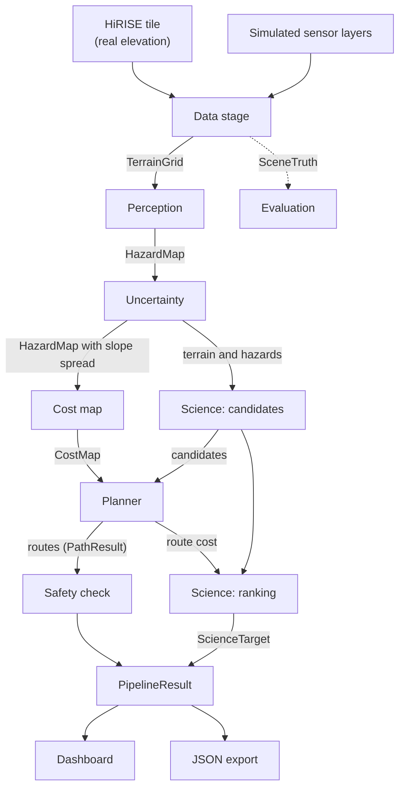

# MARS-09 Odyssey

HackInnovision 2026, Track A: Planetary Reconnaissance and Autonomous Navigation.

> Status: working prototype. The pipeline runs end to end on five real Mars tiles and a Streamlit dashboard shows the result. An HTML dashboard is in progress.

## What it does

MARS-09 is a Mars rover planner that works from orbital data. It starts from a real HiRISE elevation tile, works out which ground is safe and how sure it is, plans a route to the most valuable science targets, and checks that route a second time before showing it. Every result carries its uncertainty, and anything simulated is labelled as simulated.

## Highlights

- **Real terrain.** Two HiRISE elevation models (Jezero crater and Promethei Terra), five tiles, cached in the repo so a clone runs offline.
- **A seeded scene generator.** It reduces a tile to a 256 by 256 planning grid at 2 m, adds simulated bands, noise, gaps and one sensor conflict, and keeps a hidden answer key for evaluation.
- **Perception.** Slope, roughness and crater-rim rules, plus a Random Forest for terrain classes whose tree votes give an uncertainty. An optional CNN experiment (off by default) was measured and lost to the forest.
- **Uncertainty.** A 50 draw Monte Carlo over spatially correlated elevation noise gives a slope spread for every cell.
- **A risk-aware planner.** A cost map with a spread, A* on a CVaR edge cost with a Dijkstra cross-check, drift-margin inflation, corridors, and two baselines (B0 and B1) to compare against.
- **One dial.** Bold (alpha 0) to cautious (alpha 0.95), visible in the dashboard.
- **Safety kept separate.** Hard blocks never depend on soft cost weights. Every route is re-checked against the blocked cells, and a failing stage stops the run and names itself.
- **Science ranking.** Candidates, then a 1000 draw ranking Monte Carlo that gives each target a rank interval, a probability of being in the top 3, and a written evidence string.
- **Dashboard.** A Streamlit page with the cost map, the route, ranked targets with confidence bands, a safety badge, and controls for noise, missing data, rover mode and planner.
- **Measurement.** A per-tile results table, and a score of the science stage against the hidden answer key.
- **A rover sandbox.** The landing page, `web/index.html`, lets you drop craters, move the start and the goal, and turn the rover's dials, with the route recomputed on every change. It is a simplified browser version of the planner on a simulated surface.

## How the system works

Each run takes one tile through these stages in a fixed order. Every stage hands the next one a typed object (the contracts are in `docs/ARCHITECTURE.md`), and a stage that breaks its contract stops the run.

| Step | What happens | Code |
|---|---|---|
| 1. Read | Take a 512 by 512 window of the HiRISE file with HTTP range requests (about 1 MB) and cache it. Missing cells become NaN and are marked invalid, never filled. | `src/odyssey/data/dem.py` |
| 2. Degrade | Average 2 by 2 blocks to 256 by 256 at 2 m and add spatially correlated noise. The untouched crop is kept as the answer key. | `src/odyssey/data/scene.py` |
| 3. Simulate | Mix four materials into five spectral bands plus ice, thermal and mineral bands. Add sensor noise, missing patches and one conflict between two sensors. All tagged simulated. | `src/odyssey/data/scene.py` |
| 4. Perceive | Compute slope, roughness, step height and rim convexity. Hand-set rules label five terrain classes, a Random Forest learns them, and the tree votes give class probabilities and an uncertainty. | `src/odyssey/perception/` |
| 5. Hazard | `hazard = 1 - (1 - P_slope)(1 - P_rough)(1 - P_class)`. A cell is hard-blocked if it is steeper than 25 degrees, a crater rim, or its hazard probability is over the threshold. Cells with missing data are blocked too. | `src/odyssey/perception/hazards.py` |
| 6. Uncertainty | Re-measure slope on 50 noisy copies of the elevation and keep the mean and spread. | `src/odyssey/uncertainty/` |
| 7. Cost | `cost = 0.4 slope + 0.2 roughness + 0.4 hazard`, each scaled, with a propagated spread. Blocked cells come only from the hazard map and missing data. | `src/odyssey/planning/costmap.py` |
| 8. Science candidates | Find the strongest ice and geology signals, keeping clear of blocked ground. | `src/odyssey/science/candidates.py` |
| 9. Plan | One route per candidate in bold and cautious mode, with a Dijkstra cross-check, then corridors, baselines and a risk-versus-length curve for the default target. | `src/odyssey/planning/` |
| 10. Check and rank | Re-check every route against the blocked cells. Then rank targets with a Monte Carlo over value and weights, using the route cost. | `src/odyssey/pipeline.py`, `src/odyssey/science/ranking.py` |
| 11. Show | Save one result file per configuration. The dashboard loads it, and an exporter writes the same result as JSON for the HTML dashboard. | `src/odyssey/dashboard/`, `src/odyssey/export.py` |

What each stage hands to the next:



An interactive version of the same pipeline, with the source lines behind each box, is in `docs/architecture-diagram.html` (open it in a browser). The slide is `docs/presentation-architecture.png`, and its editable page is `docs/presentation-architecture.html`.

**What is real and what is simulated.** Only the elevation is real. The spectral, ice, thermal and mineral bands, the noise, the gaps and the sensor conflict are simulated and labelled as such in the data and on screen.

## Quick start

```bash
python setup_env.py                       # creates .venv and installs the pinned requirements
.venv\Scripts\activate                    # Windows. On Mac or Linux: source .venv/bin/activate
python -m odyssey.pipeline                # runs tile T1 and saves outputs/result_<hash>.pkl
streamlit run src/odyssey/dashboard/app.py
pytest
```

- `python setup_env.py --core` skips the dashboard packages (Streamlit, Plotly, pandas).
- The five tile crops are in `data/tiles/`, so nothing is downloaded. A new tile window fetches about 1 MB from NASA PDS the first time.
- The pins install on Python 3.11 and 3.14. The full test suite was run on them with Python 3.11.

Other commands:

Open `web/index.html` in a browser for the landing page and the rover sandbox. It needs no server.

```bash
python -m odyssey.pipeline --config my.json --force       # a different configuration, recomputed
python -m odyssey.export                                  # JSON bundle for the HTML dashboard, in outputs/web/
python -m odyssey.data.tile_report --doc docs/TILE_RESULTS.md   # one real run per tile, as a table
python -m odyssey.science.evaluate --tiles T1,T2,T3,T4,T5 --seeds 0,1,2 --noise 0.5,1,2 --candidates 5,10
```

## Results at a glance

One real run per tile with scene seed 0 and noise level 1.0. The full table, with the baselines and timings, is `docs/TILE_RESULTS.md`. Sites are never pooled.

| Tile | Site | 95th percentile slope | Blocked cells | Targets reachable (cautious) |
|---|---|---|---|---|
| T1 | Jezero | 11.7 deg | 6.1 % | 5 of 7 |
| T2 | Jezero | 9.9 deg | 5.8 % | 5 of 7 |
| T3 | Jezero | 11.7 deg | 8.1 % | 5 of 7 |
| T4 | Promethei Terra | 51.0 deg | 32.4 % | 1 of 7 |
| T5 | Promethei Terra | 22.3 deg | 13.6 % | 5 of 7 |

T4 is a large scarp, so most targets have no safe route. The system reports that instead of drawing a risky path.

The science stage was also scored against the hidden answer key on 90 scenes (5 tiles, 3 seeds, 3 noise levels, 5 and 10 candidates). The truly best target landed in the estimated top 3 in 80 percent of runs. The stated 90 percent intervals held the truth about 74 percent of the time, so they are too narrow. See `specs/03-uncertainty-science.md`.

## Approach

Who built what:

0. **Data** (Saptarshi): load the real DEM tile and generate the simulated spectral bands, noise and missing patches.
1. **Perception** (Disha): derive slope, roughness and aspect from the DEM, classify terrain, build a hazard map.
2. **Uncertainty** (Disha): Monte Carlo over DEM noise gives a mean and spread of slope for every cell.
3. **Planning** (Udit): cost map, A* with Dijkstra as a baseline, a hard safety rule, a cautious mode that penalises uncertain cells, and a loop guard so snapping a goal to a safer cell or replanning cannot oscillate (off by default).
4. **Science** (Saptarshi): rank candidate formations by value divided by cost, with confidence bands and a written evidence trail.
5. **Dashboard** (Disha): interactive view of all of the above.

## Architecture

See `docs/ARCHITECTURE.md` for the contracts and the working values. The specs in `specs/` define each module, and `docs/ROLES.md` says who owns what.

Repository map:

| Folder | Contents |
|---|---|
| `src/odyssey/data/` | Tile loader, scene generator, per-tile report, tile list (`tiles.yaml`) |
| `src/odyssey/perception/` | Slope kernels, rules, Random Forest, hazard map, optional CNN experiment |
| `src/odyssey/uncertainty/` | DEM Monte Carlo |
| `src/odyssey/planning/` | Cost map, planner, search, safety verifier, baselines |
| `src/odyssey/science/` | Candidates, ranking, evaluation against the answer key |
| `src/odyssey/dashboard/` | The Streamlit dashboard |
| `src/odyssey/pipeline.py`, `export.py`, `config.py`, `contracts.py` | Orchestration, JSON export, configuration, typed contracts |
| `data/tiles/` | The five cached tile crops |
| `docs/`, `specs/` | Architecture, results, research notes, the demo script, and one spec per module |
| `tests/` | One test file per module, plus the real-tile checks |
| `web/` | The project landing page, including the rover sandbox |

## Data and assumptions

- Real elevation data: two HiRISE digital terrain models from the NASA Planetary Data System, cropped to five 512 by 512 tiles (T1 to T5) at about 1 m per cell. Credit: NASA/JPL/University of Arizona. HiRISE states its images are public domain. No licence is stated for the DTMs themselves.
  - Product A, `DTEEC_023524_1985_023379_1985_U01`, Jezero crater (tiles T1 to T3).
  - Product B, `DTEEC_021466_1230_021954_1230_A01`, Promethei Terra (tiles T4 and T5).
  - Tile windows and source details are in `src/odyssey/data/tiles.yaml`. The cropped tiles are in `data/tiles/`.
- Simulated: spectral bands, ice signal, sensor noise, missing data patches.
- Results per tile, never pooled across sites: `docs/TILE_RESULTS.md`. Regenerate with `python -m odyssey.data.tile_report --doc docs/TILE_RESULTS.md`.
- The science stage is scored against the simulated truth with `python -m odyssey.science.evaluate`. Its stated 90 percent intervals hold the truth about 74 percent of the time (see `specs/03-uncertainty-science.md`).
- One tile per run (256 by 256 at 2 m, reduced from the 512 by 512 crop with simulated noise added), single rover, static map.

### Modelling assumptions

None of these numbers is fitted to rover data. Every one is a working assumption unless `docs/RESEARCH_NOTES.md` cites it.

- **Terrain classes are rule-derived pseudo-labels.** There is no labelled Mars terrain data in this project. Perception first labels each cell with hand-set rules on slope, roughness and crater rims (5 classes). A Random Forest is then trained on those labels. Its tree votes give the class probabilities and the epistemic spread. Because it learns the rules it was given, it agrees with them by construction. It is not an independent check on the rules. An optional small CNN (`classifier="cnn"`, needs torch) was tried in the same role. It did not match the forest on held-out tiles (macro F1 0.13 against 0.79, see `specs/01-perception.md`), so the forest is the default and the CNN is an experiment only.
- **Perception thresholds are assumptions.** This covers the slope centre (20 degrees), the roughness scale (0.25 m), the rim rule, the DEM noise (0.3 m) and the noise correlation length (20 m). They live in `src/odyssey/perception/params.py` and can be overridden through the `perception` field of `PipelineConfig`.
- **Science value is a documented score, not science.** All spectral bands are simulated, so nothing here is a claim about real ice or minerals. The formulas are in `src/odyssey/science/model.py`, all on a 0 to 1 scale:
  - Ice value is the simulated ice band, scaled from its 2nd percentile to its maximum over valid cells.
  - Geology value is distinctness times slope-free access. Distinctness is the mean of class rarity (from the terrain class probabilities) and the scaled mineral band, when present. Slope-free access is `1 - slope / hard_block_slope_deg`, clipped to 0 to 1.
  - Ranking divides value by the cautious path cost to the target.
- **Value uncertainty is built from four terms added in quadrature:** sensor noise, classifier disagreement, the share of missing data nearby, and an ice versus thermal conflict. The gains (0.05, 0.5, 0.30, 0.25) and the 0.2 lognormal spread on the target kind weights are assumptions set in `model.py`. Intervals are 90 percent.
- **The thermal conflict rule assumes a band whose name contains "thermal", where a high value means ice-consistent.** The data stage follows this convention (`thermal_simulated`, see `specs/05-data.md`).

## Known limitations

Data and science are listed here. The planner and dashboard limits are for Udit and Disha to add.

- **Only the elevation is real.** The spectral, ice, thermal and mineral bands, the noise, the gaps and the sensor conflict are simulated, so the science ranking says nothing about real ice or minerals.
- **Thermal inertia is simulated.** Real THEMIS thermal inertia (a 1.7 MB Jezero map, CC BY 4.0, and published Perseverance values of 180 to 605) has been checked as a source but is not integrated yet. It is the next priority.
- **The stated 90 percent confidence intervals are too narrow.** Measured against the simulated truth on 90 scenes, they hold the true value about 74 percent of the time and the true rank about 75 percent. They have not been calibrated yet, and the measurement is against our own simulation.
- **Terrain classes are not an independent check.** The Random Forest learns labels made by our own rules.
- **A small area, one rover, a static map.** Each run covers about 0.5 km square on a 256 by 256 grid at about 2 m, with no wheel slip or power model.
- **Two sites, five tiles, one seed each in the results table.** `docs/TILE_RESULTS.md` is a snapshot, not an average, and sites are never pooled.
- **Planted targets are not a detection test.** The science stage finds about 3 percent of them, so they are a diagnostic only.
- **Not built:** the synthetic elevation fallback and the flags for stereo artifacts in the elevation model.
- **Licence:** no licence is stated for the elevation models themselves. HiRISE images are public domain and credit is given.
- **Install pins.** The versions in `requirements.txt` install on Python 3.11 and 3.14 (checked with pip's resolver on both), and the full test suite passed on them with Python 3.11 on Windows. The 3.14 check was the resolver only, not a run. The optional `torch` pin was resolved but not installed.
- **The HTML dashboard is not finished.** The Streamlit dashboard is the working one. The exporter that feeds the HTML page exists.

## How this maps to the judging criteria

The full mapping, with where each item shows in the demo, is `docs/EVALUATION_MAP.md`.

| Criterion | Where it shows |
|---|---|
| Technical depth | Typed contracts between stages, CVaR planning with a Dijkstra cross-check, Monte Carlo at two points in the pipeline |
| Reasoning | An evidence string on every science target |
| Uncertainty and robustness | Noise, gaps and a sensor conflict in the scene, confidence bands everywhere, a measured interval coverage, per-tile results |
| Execution and explainability | Every run is reproducible from a seed, hard blocks are separate from soft cost, and a second check stops any unsafe route |
| Usability | The dashboard with a bold and cautious dial, and one saved result per run, so the demo loads instead of recomputing |

## Team

Udit Arun Nath (architecture, planning, integration), Disha (research, perception, uncertainty, dashboard), Saptarshi (data, science).

## Libraries and external resources

Data:

- HiRISE digital terrain models `DTEEC_023524_1985_023379_1985_U01` and `DTEEC_021466_1230_021954_1230_A01`, NASA Planetary Data System. Credit: NASA/JPL/University of Arizona.

Libraries (versions in `requirements.txt`):

- NumPy, SciPy and scikit-learn for the numerics and the Random Forest.
- Requests and PyYAML for the tile loader.
- pytest for the tests.
- Streamlit, Plotly and pandas for the current dashboard only.
- PyTorch (`torch`, optional): only for the CNN terrain classifier experiment. The pipeline runs without it.

Papers the design follows (the full survey, with how far each source was verified, is `docs/MODEL_AND_BASELINE_PLAN.md`):

- Brad and Balog, Electronics 2025, 14(5), 921: the B1 baseline cost.
- Sanchez-Ibanez, Sanchez-Cuevas and Olivares-Mendez, IROS 2022: the distance-growing drift margin.
